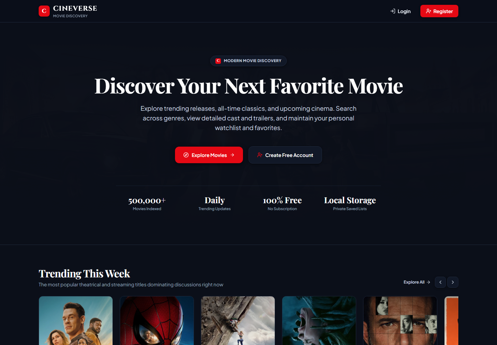
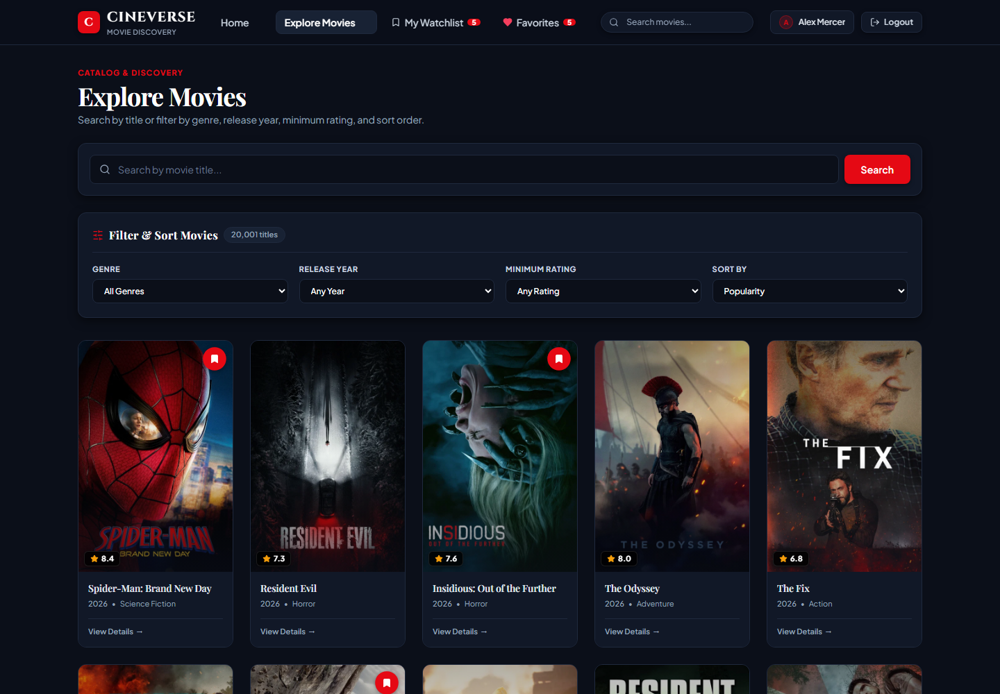
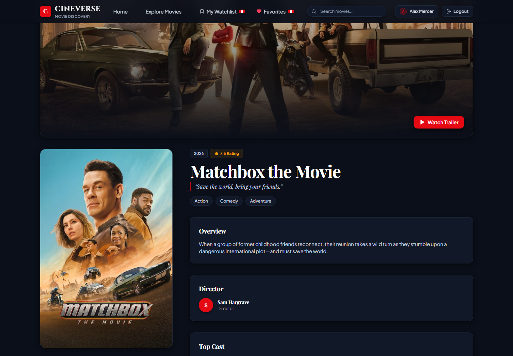
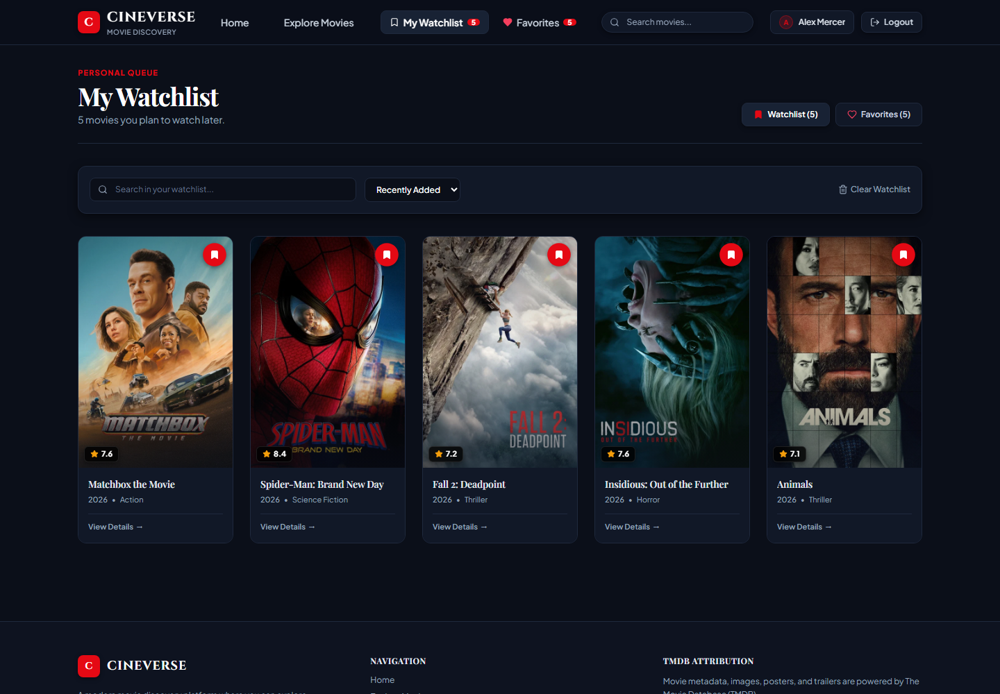
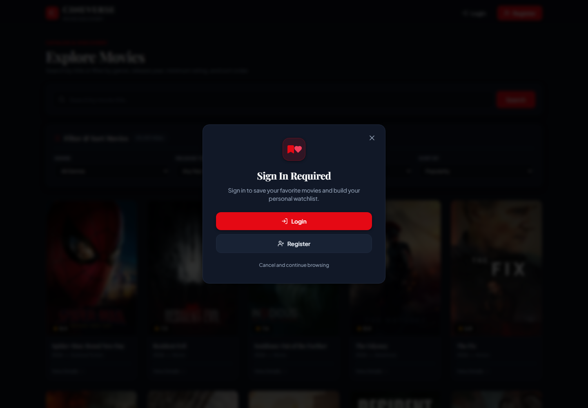

# CineVerse — Modern Movie Discovery

**CineVerse** is a responsive React 18 + Vite movie discovery web application powered by the [TMDB API](https://www.themoviedb.org/). Users can browse trending and popular releases, search by title, filter across genres, release years, and ratings, inspect full cast and trailer details, and curate per-user **Watchlist** and **Favorites** collections persisted in browser `localStorage`.

---

## Features

- **Movie Discovery & Search**: Browse trending, popular, top-rated, and upcoming movies or filter the catalog by genre, release year, minimum rating, and sort order.
- **Rich Movie Details**: View theatrical posters, backdrops, synopses, runtime, release dates, ratings, directors, top cast, embedded YouTube trailers, and similar movie recommendations.
- **Demo Authentication & Validation**: Client-side registration and login with regex form validation and Web Crypto SHA-256 salted password hashing in `localStorage`.
- **Protected Collections**: Per-user **My Watchlist** and **Favorites** pages guarded by protected routes and an interactive **Sign In Required** modal for guest users.

---

## Screenshots











> See [`screenshots/README.md`](screenshots/README.md) for the complete set of application screenshots (including Login, Registration, and Favorites views).

---

## Getting Started

### 1. Clone & Install Dependencies

```bash
git clone https://github.com/Madhan-mdn/CineVerse.git
cd CineVerse
npm install
```

### 2. Configure Environment Variables

Copy `.env.example` to `.env` and add your free TMDB v3 API key:

```bash
cp .env.example .env
```

```env
VITE_TMDB_API_KEY=your_tmdb_api_key_here
```

*(If no API key is configured, CineVerse automatically falls back to its built-in offline movie catalog.)*

### 3. Run Development Server or Build

```bash
# Start Vite dev server at http://localhost:3000
npm run dev

# Build for production
npm run build
```
